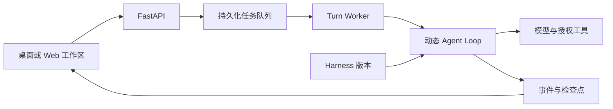

<p align="center">
  
</p>

<h1 align="center">HarnessAgent</h1>

<p align="center">在本地管理项目、运行智能体任务，并连接你的模型与工具。</p>

<p align="center">
  <a href="https://github.com/FueTsui/HarnessAgent/releases/latest"></a>
  
  
  <a href="https://github.com/FueTsui/HarnessAgent/actions/workflows/security-regression.yml"></a>
</p>

<p align="center">
  <a href="https://github.com/FueTsui/HarnessAgent/releases/latest">下载桌面版</a> ·
  <a href="#安装与使用">快速开始</a> ·
  <a href="docs/USAGE.md">使用指南</a> ·
  <a href="#接口">接口说明</a> ·
  <a href="https://github.com/FueTsui/HarnessAgent/issues">反馈问题</a>
</p>

HarnessAgent 是一个支持多轮对话、工具调用与任务持久化的智能体平台，提供 Windows 独立桌面版和可从源码运行的 Web 工作区。你可以按项目组织任务，为智能体配置模型、Skill、MCP 和知识库，在对话中查看执行进度、补充要求、处理审批并下载产物。

平台使用 FastAPI、持久化 Worker 和动态 Agent Loop：智能体根据任务选择下一步操作，指令与运行策略通过可发布、可回滚的 Harness 版本管理。

## 主要特性

- **项目与多轮任务**：项目、任务侧栏、附件和历史记录集中管理，提供明暗主题与桌面快捷键。
- **动态执行与过程回放**：按任务生成计划，记录工具、审批、验证和终态事件，支持检查点恢复。
- **运行中补充要求**：继续引导当前任务、排队下一条消息，或打断后创建后继任务。
- **模型与阶段路由**：配置执行、规划、路由和验证模型，支持连接 OpenAI 兼容的本地模型服务。
- **可组合的工具能力**：接入 Skill、MCP、知识库和自定义服务，使用文件、Git、浏览器、文档与联网检索工具。
- **权限与审批**：按账户和智能体分配能力，结合内容护栏、工具审批及用户工作区隔离控制执行范围。
- **任务调度与消息渠道**：Cron 任务和个人微信消息进入同一套执行与审计流程。
- **版本与改进实验室**：生成候选策略、运行回归评估，人工批准后再发布新版本。

## 安装与使用

### Windows 桌面版

适用于 **Windows 10/11 x64**，内置 Electron/Chromium、Python 运行时和依赖。

1. 从 [Releases](https://github.com/FueTsui/HarnessAgent/releases/latest) 下载桌面 ZIP，**完整解压**后双击 `HarnessAgent.exe`。
2. 点击登录页的“首次使用？查看本机登录信息”，用自动生成的 `root` 账号和随机密码登录。
3. 在后台配置模型提供商，为智能体选择模型；全新数据目录自带“通用助手”。
4. 新建任务，输入要求；按需附加文件、选择能力并查看运行过程。

| 操作 | 快捷键 |
| --- | --- |
| 新建任务 | `Ctrl+N` |
| 打开设置 | `Ctrl+,` |

桌面版默认只监听 `127.0.0.1`，从 `17650` 起寻找可用端口，窗口自动连接。默认数据目录为 `%LOCALAPPDATA%\HarnessAgent`。升级前先关闭应用并备份整个数据目录，再将新版解压到新目录。

模型权重和 API Key 由使用者自行准备。桌面窗口无需系统浏览器；智能体的浏览器工具仍需要系统 Chrome 或 Edge。数据目录、自定义启动参数和升级注意事项见 [Windows 本地版说明](docs/local-agent-windows.md)。

### 从源码运行

以下命令使用 **CPython 3.12** 和仓库中的哈希锁定依赖，在独立的开发数据目录启动本地服务：

```powershell
git clone https://github.com/FueTsui/HarnessAgent.git
cd HarnessAgent
py -3.12 -m venv .venv
.\.venv\Scripts\python.exe -m pip install --require-hashes -r requirements.lock
.\.venv\Scripts\python.exe local_agent.py serve --home .\data\dev-home --port 17650
```

打开终端显示的 `Harness Agent ready` 地址。首次登录信息保存在所选数据目录的 `first-run.txt`，登录后即可配置模型并运行任务；按 `Ctrl+C` 停止服务。该启动方式使用独立数据目录，不复用项目根目录的部署配置。

已有部署使用 `run.py`，其环境配置、独立 Worker 和迁移要求见 [部署与配置](docs/USAGE.md#部署与配置)。

## 接口

<details>
<summary>查看能力接口、配置与兼容性</summary>

### 能力概览

| 能力 | SDK 函数 | CLI 命令 | MCP 工具 | HTTP 入口 | 副作用级别 |
| --- | --- | --- | --- | --- | --- |
| 管理智能体 | — | — | — | `GET/POST /api/v1/agents`、`PATCH /api/v1/agents/{id}` | 读取或本地写入 |
| 创建对话任务 | — | — | — | `POST /api/v1/chat` | 本地写入、外联，可能计费 |
| 读取任务事件 | — | — | — | `GET /api/v1/chat/turns/{id}/stream` | 只读 |
| 第三方任务调用 | — | — | — | `POST /open/v1/chat` | 本地写入、外联，可能计费 |

### SDK

当前未提供独立发布的 SDK；外部系统通过 HTTP API 集成。

### CLI

`local_agent.py serve` 提供本地服务启动入口，`run.py` / `run.py worker` 用于部署 API 与独立 Worker；当前未提供通用任务 CLI。参数、退出码和进程控制见 [启动入口](docs/USAGE.md#启动入口)。

### MCP

平台作为 MCP 客户端接入 **Streamable HTTP、SSE 和 stdio** 服务，可在工具页导入标准 `mcpServers` JSON。本地进程由 `root` 注册并授权；连接方式与权限边界见 [MCP 与自定义服务](docs/USAGE.md#mcp-与自定义服务)。

### HTTP API

使用当前服务地址作为基址：`/docs` 提供交互文档，`/openapi.json` 提供 OpenAPI Schema。Web 工作区使用会话 Cookie；`/open/v1/*` 使用 `X-API-Key`，并按所属账号检查资源权限。接口列表、任务轮询、限流和错误格式见 [HTTP API 参考](docs/USAGE.md#http-api-参考)。

### 配置与凭据

| 配置 | 用途 |
| --- | --- |
| `APP_HOST` / `APP_PORT` | `run.py` 的监听地址与端口 |
| `APP_DATA_DIR` / `AGENT_WORKSPACE_ROOT` | 数据根目录与隔离工作区 |
| `DATABASE_URL` | 部署使用的数据库连接 |
| `JWT_SECRET` / `SECRET_MASTER_KEY` / `ROOT_PASSWORD` | 身份认证、凭据加密与首次账号初始化 |

本地启动器自动初始化自己的配置；源码部署由部署方注入环境变量或管理配置文件。凭据不写入命令行、仓库或日志；使用 1Password 时，由部署方维护引用并注入进程。完整说明见 [配置与凭据](docs/USAGE.md#配置与凭据)。

### 兼容性

| 运行方式 | 当前范围 |
| --- | --- |
| 独立桌面包 | Windows 10/11 x64 |
| 源码与桌面构建基线 | CPython 3.12；桌面构建需 Windows x64 |
| 自动化回归配置 | Windows、Ubuntu；真实浏览器冒烟配置在 Windows |
| macOS / Linux 桌面包 | 当前未提供 |

工作流配置不代表某次运行已通过；实际状态以 [Actions](https://github.com/FueTsui/HarnessAgent/actions/workflows/security-regression.yml) 和对应发布记录为准。

</details>

## 开发与构建

前端与桌面入口语法检查：

```powershell
.\.venv\Scripts\python.exe tools\check_javascript.py
node --check desktop\main.cjs
node --check desktop\preload.cjs
node --check desktop\splash.js
```

应用回归在隔离环境运行，准备方式见 [开发验证](docs/USAGE.md#开发验证)。构建 Windows 独立桌面包：

```powershell
powershell -ExecutionPolicy Bypass -File .\tools\build_desktop.ps1 `
  -BuildPython (Resolve-Path .\.venv\Scripts\python.exe).Path
```

产物目录为 `dist/HarnessAgent-Desktop`，ZIP 和校验记录见构建输出。构建使用锁定的 Electron、CPython 和依赖，并校验下载文件；详细要求见 [构建说明](docs/local-agent-windows.md#从源码构建)。

<details>
<summary>查看项目结构与执行架构</summary>

```text
backend/           FastAPI、Agent Loop、权限、工具与任务调度
frontend/          对话工作区与管理控制台
desktop/           Electron 桌面窗口与本地服务管理
migrations/        数据库迁移
packaging/         本地程序启动器与默认品牌资源
tools/             构建、备份、发布预检与验证工具
tests/             应用与安全回归
docs/              使用、模型路由与运行时说明
```



状态按 `Project → Thread → Turn → Item` 分层；队列负责领取、租约、重试与取消，任务过程通过追加式事件记录。完整说明见 [架构文档](ARCHITECTURE_HARNESS_2026-07-29.md) 和 [运行时升级说明](docs/execution-runtime-upgrade.md)。

</details>

## 文档索引

| 文档 | 内容 |
| --- | --- |
| [使用指南](docs/USAGE.md) | 对话控制、附件、能力配置、护栏、微信与 API |
| [Windows 本地版](docs/local-agent-windows.md) | 首次启动、数据目录、升级、自定义参数与打包 |
| [模型职责与路由](docs/agent-model-routing.md) | 阶段模型、继承规则、协议限制与回退 |
| [架构设计](ARCHITECTURE_HARNESS_2026-07-29.md) | Harness、Agent Loop 与状态模型 |
| [运行时升级](docs/execution-runtime-upgrade.md) | 检查点、调用账本、恢复语义与迁移 |
| [发布与回滚](RELEASE.md) | 生产预检、数据库备份、恢复与密钥轮换边界 |
| [发行记录](https://github.com/FueTsui/HarnessAgent/releases) | 已发布版本、下载文件与版本说明 |

## 已知限制

- 模型推理由配置的服务提供；云模型及部分工具需要联网，并可能产生费用。
- 内置 Shell 默认关闭；Git、浏览器和用户注册的 MCP / 编程服务需要对应程序与授权。
- SQLite 仅用于单机部署；检查点不保证任意外部副作用恰好执行一次，恢复边界见运行时文档。
- Windows 发布 EXE 尚未进行代码签名。

## 反馈与贡献

通过 [Issues](https://github.com/FueTsui/HarnessAgent/issues) 提交问题或建议。问题报告请附版本、运行方式、复现步骤与脱敏日志；提交改动时同步更新相关文档，并说明验证范围。请勿上传模型凭据、首次登录信息或个人数据目录。

## 许可

当前仓库未提供项目 `LICENSE` 文件，桌面应用元数据标记为 `UNLICENSED`。第三方组件的许可随对应组件分发。
